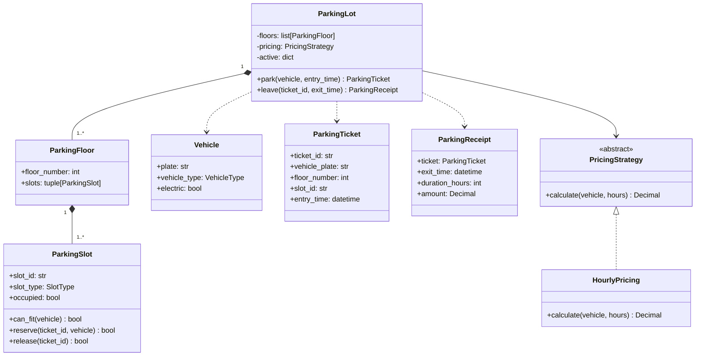

# Smart Parking Lot — UML

## Allocation rule
First-fit: scan floors in ascending configured order and each floor's slots in configured order. A slot is reserved atomically under its own lock. The lot-level lock prevents duplicate active vehicle tickets and coordinates allocation/checkout in this in-memory model.
